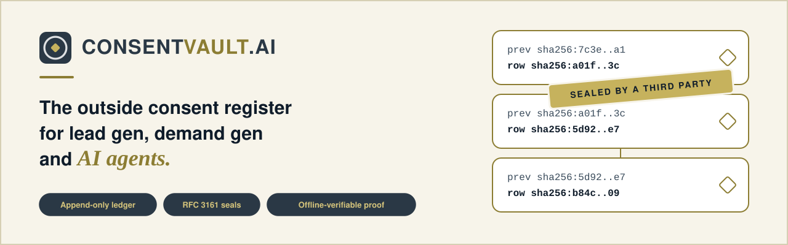
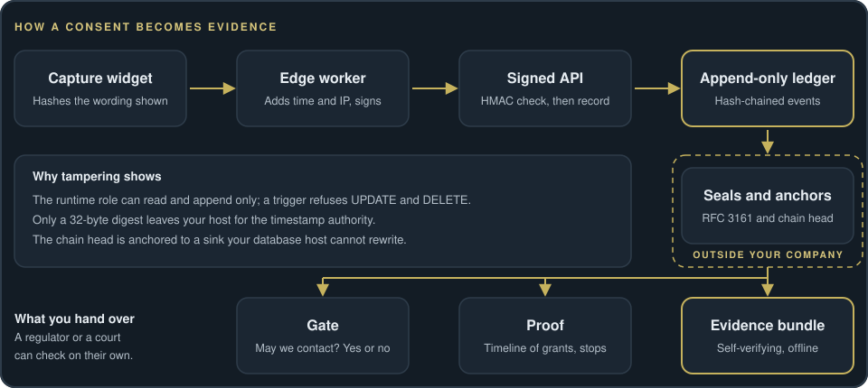

<p align="center">
  <picture>
    <source media="(prefers-color-scheme: dark)" srcset=".github/assets/banner-dark.svg">
    <source media="(prefers-color-scheme: light)" srcset=".github/assets/banner-light.svg">
    
  </picture>
</p>

<p align="center">
  <a href="LICENSE"></a>
  
  
</p>

<p align="center"><b>An open-source consent evidence vault: a tamper-evident record of who agreed to be contacted, how, under which exact wording, and who later said stop.</b><br>
<a href="https://consentvault.ai">consentvault.ai</a></p>

It exists to preserve the evidence behind one question: **"What was recorded about this person's consent to this contact, and about any withdrawal of it?"**

> **Scope.** ConsentVault is an independent evidence custodian and compliance-support infrastructure. It is not a
> legal authority and it gives no legal advice. It preserves documentation, not guaranteed compliance.
> Whether a consent is legally valid, whether a disclosure satisfies a law, and whether a communication is permitted
> are determinations for you and the counsel you choose to involve. Read [docs/scope.md](docs/scope.md).

## Why

- A consent record kept as a flag in a CRM says "yes" and nothing else: not what the person saw, when, or whether anyone edited it afterwards.
- ConsentVault keeps the evidence instead of the flag: every event is append-only, hash-chained, and timestamped by an authority you do not run.
- The vault's code, including the code that writes and checks each record, is MIT licensed; the records stay private to whoever runs it. You can read the code, run it yourself, and check a record without trusting us. See [docs/why-open-source.md](docs/why-open-source.md). The managed service's key provider and support answer service are not in this repository.

## What it is

An open-source consent evidence vault, written in Python on PostgreSQL. It stores what was recorded: the box as it was left, the exact wording by its sha256, the time, and what the server received. It then lets anyone check that none of it changed. It is deterministic code with no model on the record path: the same input gives the same output.

<table>
<tr>
<td width="33%" valign="top"><b>Append-only</b><br>Events are inserted, never updated or deleted. A database trigger refuses both.</td>
<td width="33%" valign="top"><b>Chained and anchored</b><br>Every event carries the hash of the one before it, over every evidence column. <code>consentvault anchor</code> writes the chain head to a sink outside the database, so a cut tail is detected.</td>
<td width="33%" valign="top"><b>Sealed outside</b><br>Each event's digest is timestamped by an independent RFC 3161 authority. Only a 32-byte digest leaves your host.</td>
</tr>
<tr>
<td valign="top"><b>Separate roles</b><br>On the event ledger the runtime role can only read and insert. It owns nothing and cannot change history, the schema or the triggers; only the owner role migrates.</td>
<td valign="top"><b>The wording is evidence</b><br>The exact disclosure text is stored once by its sha256, and every grant references it by hash.</td>
<td valign="top"><b>Stops count as much as grants</b><br>Events are ordered by arrival, never by a time the caller claims. <code>--purpose '*'</code> withdraws every purpose on the channel or channels named; a stop applies to its channel, under the rule in the permission view (migrations/0075_permission_by_arrival.sql).</td>
</tr>
<tr>
<td valign="top"><b>Fail closed, with a reason</b><br>If the vault cannot answer, the answer is <code>unavailable</code>, with a named reason. The answer reports what the record shows, not a legal conclusion.</td>
<td valign="top"><b>Capture edge included</b><br>A dependency-free edge worker and an embeddable checkbox widget that hashes the wording on screen at submit time.</td>
<td valign="top"><b>Self-verifying evidence</b><br>Export a bundle a reviewer can check with only Python and openssl, using trust roots and anchors taken from outside the bundle.</td>
</tr>
</table>

## How it works

<p align="center">
  
</p>

The widget sends what the visitor did: the box exactly as it was (ticked or not), the moment of the choice with its
offset, and the text that was on screen beside its hash. The edge worker adds what only a server knows (receipt time, IP
address, bot-check answer) and forwards the browser's own request in one signed envelope. The vault writes every request it
receives, whole and unchanged, to an append-only chain before anything reads it, and answers with a receipt carrying the
fingerprint of what it stored; nothing about a capture is refused. The consent value is then read from the stored bytes
exactly as it was sent. Seals and anchors live outside your company's control. The gate, the consent timeline and the evidence bundle all read the same ledger. See
[ARCHITECTURE.md](ARCHITECTURE.md) for the design.

## Quick start (about 5 minutes)

You need Docker with the Compose plugin, `openssl`, `curl` and Python 3. Everything below runs on your machine. Once it is running, the only outside call the vault makes is to the timestamp authority, which receives a 32-byte digest and nothing else. This example uses the public authority at freetsa.org; choose your own for real use.

```
git clone https://github.com/ndnstyl/consentVault.git && cd consentVault

# 1. Settings: random passwords, a timestamp authority, and a folder the vault writes to.
export CONSENTVAULT_ADMIN_PASSWORD=$(openssl rand -hex 16)
export CONSENTVAULT_MIGRATOR_PASSWORD=$(openssl rand -hex 16)
export CONSENTVAULT_OPERATOR_PASSWORD=$(openssl rand -hex 16)
export CONSENTVAULT_APP_PASSWORD=$(openssl rand -hex 16)
export CONSENTVAULT_API_SECRET=$(openssl rand -hex 32)
export CONSENTVAULT_API_TOKEN=$(openssl rand -hex 32)
export CONSENTVAULT_PURPOSES=marketing,service
export CONSENTVAULT_TSA_URL=https://freetsa.org/tsr
export CONSENTVAULT_ANCHOR_SINK=/out/anchors/anchors.jsonl   # a file here; in production use a sink the database host cannot rewrite
mkdir -p out/anchors out/bundle && chmod -R 777 out          # the vault runs as an unprivileged user
curl -sS -o out/tsa-root.pem https://freetsa.org/files/cacert.pem

# 2. Start the database, apply the schema, start the service.
docker compose up -d db
docker compose run --rm migrate
docker compose up -d vault

# 3. Check that it answers (no record yet, so it says so).
curl -s --retry 10 --retry-delay 1 --retry-connrefused --retry-all-errors -H "Authorization: Bearer $CONSENTVAULT_API_TOKEN" \
  "http://127.0.0.1:8080/v1/permission?contact=%2B15555550100"
```

The last call returns `"status": "no_record_found"`. Now record one consent and seal it:

```
cv() { docker compose run --rm -e CONSENTVAULT_TSA_CAFILE=/out/tsa-root.pem -v "$PWD/out:/out" vault consentvault "$@"; }

cv disclosure register --body "I agree to receive texts about my account. Reply STOP to end." \
  --label signup-form --channel sms --purpose marketing        # prints the sha256 of the wording
cv capture --contact "+15555550100" --checked --disclosure <sha256-from-above> \
  --channel sms --purpose marketing --session-ref demo-1 --page-url https://www.example.com/signup
cv seal            # timestamp the new events with the authority
cv anchor          # write the chain head to the sink
cv verify-chain    # recompute the chain from the database
```

Wording must be registered before a grant names it, and a grant may not name a channel or purpose its wording does not. The post is still stored whole and unchanged, so the record shows exactly what was received; the refusal applies to the grant, not to the stored post.

### Verify a record offline

Export the person's record as a bundle, then check it with nothing but Python and `openssl`. The trust root and the anchors come from outside the bundle, so the bundle cannot vouch for itself.

```
cv export "+15555550100" --out /out/bundle
cd out/bundle
python3 verify.py --cafile ../tsa-root.pem --anchors ../anchors/anchors.jsonl
```

A good run ends with `RESULT PASS`. The check fails if the chain does not start at the first event, does not reach every anchor you supply, has a link that does not recompute, or has an event with no seal. A timestamp shows a digest existed at a time; it does not show who ticked the box. Read [docs/evidence-model.md](docs/evidence-model.md).

### Clean up

```
cd ../..
docker compose --profile tools down -v    # removes the containers and the database volume
```

`out/` holds your demo bundle and anchors; delete it when you are done. For a hardened stack (write-once evidence store, key custody, sign-in) see [docs/selfhost.md](docs/selfhost.md).

### Without Docker

`uv sync` (or `pip install -e .[dev]`), point `CONSENTVAULT_DSN` at a PostgreSQL 15+ database,
run `consentvault migrate` with `CONSENTVAULT_OWNER_DSN` set (the migrator login), then use the restricted `CONSENTVAULT_DSN` for
everything else. See [deployment](docs/deployment.md).

### Command line tour

| Command | What it does |
|---|---|
| `consentvault migrate` | apply pending migrations as the owner role; refuses a changed, missing or out-of-order file |
| `consentvault disclosure register` | store the exact consent wording and print its sha256 |
| `consentvault capture` | record a checked consent box as a grant event; `--verification otp` records that you verified the person controls the contact point; `--inbound-message` stores the post exactly as received, creates no consent, lifts no stop, and exits with the named reason |
| `consentvault revoke` | record that a person withdrew consent (`--purpose '*'` withdraws every purpose on the channel or channels named; a stop applies to its channel) |
| `consentvault verify-chain` | recompute the hash chain, check every anchor, report any break |
| `consentvault anchor` | write the current chain head to `chain_head` and the external sink |
| `consentvault may-contact` | print the facts and history recorded for a contact point (exit 1 = the record could not be read, exit 2 = bad input). A contact with a stop on record still exits 0, so exit 0 is not permission to contact |
| `consentvault seal` / `consentvault verify-seals` | timestamp events with the authority; re-verify every stored seal |
| `consentvault proof` | full timeline for a contact: grants, stops, seal status, and a reading of each channel and purpose under the rule in the permission view (migrations/0075_permission_by_arrival.sql); its `allowed` field is that reading, not permission to contact |
| `consentvault export` | write a self-verifying evidence bundle (verify it with `verify.py --cafile <root> --anchors <sink file>`) |
| `consentvault classify` | a reading of the text you pass in; it writes nothing |
| `consentvault serve` | run the HTTP API |

A clear or empty result is not permission to contact. Whether a contact is permitted is for the customer's counsel to decide.

Run `consentvault --help` for the commands installed in your version.


## Evidence exports

ConsentVault.AI preserves facts: what was shown (by hash), what was submitted, when the server received it, from
which address and user agent, what the bot check said, and a hash chain plus an independent timestamp over all of
it. These records are evidence your counsel may use in an investigation or dispute. Storing them does not establish
that a consent is valid.

`consentvault export` writes a self-verifying bundle for one person: every event, the DER timestamp tokens, the
disclosure wordings and a `verify.py`. A reviewer needs only Python and openssl to check that the records are unchanged since they were sealed. The trust
root and the anchors come from outside the bundle, so the bundle cannot vouch for itself:

```
python verify.py --cafile <timestamp-authority-root.pem> --anchors <anchor-sink-file>
```

The check fails if the chain does not start at the first event, does not reach every anchor you supply, has
a link that does not recompute, or has an event with no seal. Read [docs/evidence-model.md](docs/evidence-model.md).

## Security model and limits

- **This is not legal advice, and not a guarantee of compliance.** ConsentVault.AI preserves evidence; it does not
  decide what the law requires of you. Which wording to use, which channels need which kind of consent, how long to
  keep records, and what a court or regulator will accept are your decisions. Involving qualified counsel in your
  own jurisdiction is recommended as best practice and is your choice.
- A timestamp shows that a digest existed at a time. It does not show who ticked the box.
- A text, START included, is stored as received and lifts no stop. The way back is a later consent through your form, on the same contact point.
- An evidence bundle can be checked for an unbroken chain only against anchors the verifier takes from the anchor sink itself;
  events after the newest anchor you hold are not covered.
- If the capture surface is compromised before the vault sees the data, the vault records what it was told.
- A deployment that skips the RFC 3161 timestamp seals still has a chain, but the chain alone cannot show
  that the whole database was not rewritten. A deployment that never runs `consentvault anchor` cannot detect a
  deleted tail either: anchor on a schedule, to a sink the database host cannot rewrite.
- Integrations (CRMs, dialers, messaging providers) are adapters you write or configure; ConsentVault.AI does not
  enforce anything in systems it does not control.

Report a vulnerability as described in [SECURITY.md](SECURITY.md). Read [CONTRIBUTING.md](CONTRIBUTING.md) before opening a pull request.

## Repository layout

- `src/consentvault/`: the Python package (only required dependency: `psycopg`).
- `migrations/`: ordered SQL with a matching `down/` file for each.
- `edge/`: an optional dependency-free capture worker and an embeddable checkbox widget.
- `docs/`: documentation (below).

## Documentation

| Guide | What is in it |
|---|---|
| [Architecture](ARCHITECTURE.md) | principles, data model, modules |
| [Scope and responsibilities](docs/scope.md) | what ConsentVault provides, what you and your counsel decide |
| [Evidence model](docs/evidence-model.md) | what is recorded, what a seal covers, what it does not show |
| [HTTP API](docs/api.md) | signed event intake, permission and proof endpoints |
| [Adapters](docs/adapters.md) | CRM and messaging interfaces |
| [Why it is open source](docs/why-open-source.md) | what is open and how anyone can check it |
| [Deployment](docs/deployment.md) | requirements, database roles, configuration |
| [Capture edge](edge/README.md) | the worker and the checkbox widget |
| [Changelog](CHANGELOG.md) | what changed in each release |

## Contributing

Small on purpose: one job, few dependencies, typed errors. Append-only is the product, so no change may add an
update or delete path to the event ledger. Every change ships with tests, and a bug fix starts with a failing
test. Read [CONTRIBUTING.md](CONTRIBUTING.md) before opening a pull request.

## License

ConsentVault.AI is an open-source software project developed and maintained by **The Innovative Native LLC**.

The project is released under the **MIT License**, permitting free use, modification, distribution, and commercial deployment in accordance with the license terms.

Copyright © 2026 The Innovative Native LLC.

See the [LICENSE](LICENSE) file for the complete license terms.
