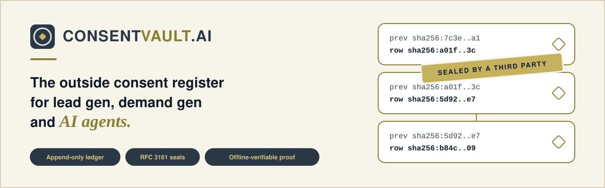
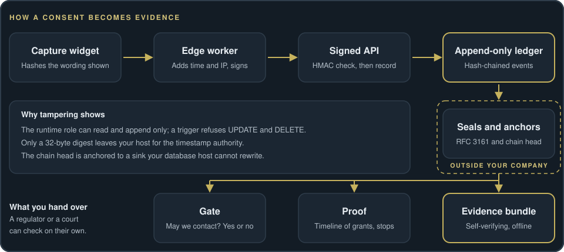

<p align="center">
  <picture>
    <source media="(prefers-color-scheme: dark)" srcset=".github/assets/banner-dark.svg">
    <source media="(prefers-color-scheme: light)" srcset=".github/assets/banner-light.svg">
    
  </picture>
</p>

<p align="center">
  <a href="LICENSE"></a>
  
  
  
</p>

<p align="center"><b>An open-source consent vault: a tamper-evident record of who agreed to be contacted, how, under which exact wording, and who later said stop.</b><br>
<a href="https://www.consentvault.ai">consentvault.ai</a></p>

It exists to answer one question under scrutiny: **"Prove this person agreed to this contact, and that they had not withdrawn it."**

## Why ConsentVault

Consent records usually live as a flag in a CRM. A flag says "yes" and nothing else: not what the person
saw, not when, not from where, not whether anyone edited it afterwards. ConsentVault keeps the evidence instead
of the flag.

<table>
<tr>
<td width="33%" valign="top"><b>Append-only</b><br>Events are inserted, never updated or deleted. A database trigger refuses both.</td>
<td width="33%" valign="top"><b>Chained and anchored</b><br>Every event carries the hash of the one before it, over every evidence column. <code>consentvault anchor</code> writes the chain head to a sink outside the database, so a cut tail is detected.</td>
<td width="33%" valign="top"><b>Sealed outside</b><br>Each event's digest is timestamped by an independent RFC 3161 authority. Only a 32-byte digest leaves your host.</td>
</tr>
<tr>
<td valign="top"><b>Two database roles</b><br>The runtime role can read and append, nothing else. It owns nothing and cannot change history, the schema or the triggers; only the owner role migrates.</td>
<td valign="top"><b>The wording is evidence</b><br>The exact disclosure text is stored once by its sha256, and every grant references it by hash.</td>
<td valign="top"><b>Stops count as much as grants</b><br>Events are ordered by arrival, never by a time the caller claims. A stop outranks a grant until the person's own later, verified grant is released under the release rule. A stop for <code>*</code> stops every purpose.</td>
</tr>
<tr>
<td valign="top"><b>Fail closed, with a reason</b><br>If the vault cannot answer, the answer is "no", with a named reason.</td>
<td valign="top"><b>Capture edge included</b><br>A dependency-free edge worker and an embeddable checkbox widget that hashes the wording on screen at submit time.</td>
<td valign="top"><b>Self-verifying evidence</b><br>Export a bundle a reviewer can check with only Python and openssl, without trusting you or this project.</td>
</tr>
</table>

## How it works

<p align="center">
  
</p>

The widget sends only the hash of the wording it showed. The edge worker adds what only a server knows (receipt
time, IP address, user agent, bot-check result) and signs the forward. The vault stamps its own receipt time,
chains the event, and refuses a grant whose wording it does not hold. Seals and anchors live outside your
company's control. The gate, the proof timeline and the evidence bundle all read the same ledger. See
[ARCHITECTURE.md](ARCHITECTURE.md) for the design.

## Quickstart

```
git clone https://github.com/ndnstyl/consentVault.git && cd consentVault
export CONSENTVAULT_ADMIN_PASSWORD=$(openssl rand -hex 16)   # bootstrap role, used once to create the two below
export CONSENTVAULT_OWNER_PASSWORD=$(openssl rand -hex 16)   # owns the schema; only `migrate` uses it
export CONSENTVAULT_APP_PASSWORD=$(openssl rand -hex 16)     # runtime role: SELECT and INSERT only
export CONSENTVAULT_API_SECRET=$(openssl rand -hex 32)       # signs capture-edge requests
export CONSENTVAULT_API_TOKEN=$(openssl rand -hex 32)        # bearer token for read endpoints
export CONSENTVAULT_PURPOSES=marketing,service               # the purposes your consent may name
export CONSENTVAULT_TSA_URL=https://tsa.example.com/rfc3161
export CONSENTVAULT_ANCHOR_SINK=https://anchors.example.com/hook   # where `consentvault anchor` writes the chain head
docker compose up -d --build db
docker compose run --rm migrate
docker compose up -d vault
```

Record a grant. The wording must be registered first by an operator, because the vault refuses a grant whose
wording it does not hold, and a grant may not name a channel or purpose its wording does not:

```
docker compose run --rm vault consentvault disclosure register \
  --body "I agree to receive texts about my account. Reply STOP to end." \
  --label signup-form --channel sms --purpose marketing   # prints the sha256 to use below
docker compose run --rm vault consentvault capture \
  --contact "+15555550100" --checked \
  --disclosure <sha256-of-the-wording> \
  --channel sms --purpose marketing \
  --session-ref demo-1 --page-url https://www.example.com/signup
docker compose run --rm vault consentvault anchor
docker compose run --rm vault consentvault verify-chain
```

### Without Docker

`uv sync` (or `pip install -e .[dev]`), point `CONSENTVAULT_DSN` at a PostgreSQL 15+ database,
run `consentvault migrate` with `CONSENTVAULT_OWNER_DSN` set (the owner role), then use the restricted `CONSENTVAULT_DSN` for
everything else. See [deployment](docs/deployment.md).

### Command line tour

| Command | What it does |
|---|---|
| `consentvault migrate` | apply pending migrations as the owner role; refuses a changed, missing or out-of-order file |
| `consentvault disclosure register` | store the exact consent wording and print its sha256 |
| `consentvault capture` | record a checked consent box as a grant (unchecked is refused); `--verification otp` or `--verification inbound_keyword --inbound-message START` records that you verified the person controls the contact point, which a stop's release requires |
| `consentvault revoke` | record that a person withdrew consent (`--purpose '*'` withdraws every purpose) |
| `consentvault verify-chain` | recompute the hash chain, check every anchor, report any break |
| `consentvault anchor` | write the current chain head to `chain_head` and the external sink |
| `consentvault may-contact` | ask whether a contact point may be contacted on a channel for a purpose |
| `consentvault seal` / `consentvault verify-seals` | timestamp events with the authority; re-verify every stored seal |
| `consentvault proof` | full timeline for a contact: grants, stops, current permission, seal status |
| `consentvault export` | write a self-verifying evidence bundle (verify it with `verify.py --cafile <root> --anchors <sink file>`) |
| `consentvault classify` | classify an inbound message as stop, not stop, or needs review |
| `consentvault serve` | run the HTTP API |

Run `consentvault --help` for the commands installed in your version.


## Evidence you can hand to anyone

ConsentVault.AI stores facts that are hard to dispute: what was shown (by hash), what was submitted, when the server
received it, from which address and user agent, what the bot check said, and a hash chain plus an
independent timestamp over all of it.

`consentvault export` writes a self-verifying bundle for one person: every event, the DER timestamp tokens, the
disclosure wordings and a `verify.py`. A reviewer needs only Python and openssl. The trust root and the anchors
come from outside the bundle, so the bundle cannot vouch for itself:

```
python verify.py --cafile <timestamp-authority-root.pem> --anchors <anchor-sink-file>
```

The check fails if the chain does not start at the first event, does not reach every anchor you supply, has
a link that does not recompute, or has an event with no seal. Read [docs/evidence-model.md](docs/evidence-model.md).

## Security model and limits

- **This is not legal advice.** ConsentVault.AI records evidence; it does not decide what the law requires of you.
  Which wording to use, which channels need which kind of consent, how long to keep records, and what a
  court or regulator will accept are questions for your own lawyer in your own jurisdiction. Get your own
  legal review before relying on it.
- A timestamp proves a digest existed at a time. It does not prove who ticked the box.
- A web-form grant never lifts a stop: only a grant the integrator marks as verified (a one-time code the
  integrator checked, or an inbound START message) does. The vault records the claim; the code check is yours.
- An evidence bundle proves the chain only against anchors the verifier takes from the anchor sink itself;
  events after the newest anchor you hold are not covered.
- If the capture surface is compromised before the vault sees the data, the vault records what it was told.
- A deployment that skips the RFC 3161 timestamp seals still has a chain, but the chain alone cannot show
  that the whole database was not rewritten. A deployment that never runs `consentvault anchor` cannot detect a
  deleted tail either: anchor on a schedule, to a sink the database host cannot rewrite.
- Integrations (CRMs, dialers, messaging providers) are adapters you write or configure; ConsentVault.AI does not
  enforce anything in systems it does not control.

Report a vulnerability as described in [SECURITY.md](SECURITY.md).

## Repository layout

- `src/consentvault/`: the Python package (only dependency: `psycopg`).
- `migrations/`: ordered SQL with a matching `down/` file for each.
- `edge/`: an optional dependency-free capture worker and an embeddable checkbox widget.
- `docs/`: documentation (below).

## Documentation

| Guide | What is in it |
|---|---|
| [Architecture](ARCHITECTURE.md) | principles, data model, modules |
| [Evidence model](docs/evidence-model.md) | what is recorded, what a seal covers, what it does not prove |
| [HTTP API](docs/api.md) | signed event intake, permission and proof endpoints |
| [Adapters](docs/adapters.md) | CRM and messaging interfaces |
| [Deployment](docs/deployment.md) | requirements, database roles, configuration |
| [Capture edge](edge/README.md) | the worker and the checkbox widget |
| [Changelog](CHANGELOG.md) | what changed in each release |

## Contributing

Small on purpose: one job, few dependencies, typed errors. Append-only is the product, so no change may add an
update or delete path to the event ledger. Every change ships with tests, and a bug fix starts with a failing
test. Read [CONTRIBUTING.md](CONTRIBUTING.md) before opening a pull request.

## License

ConsentVault.AI is an open-source software project developed and maintained by **The Innovative Native LLC**.

The project is released under the **MIT License**, permitting free use, modification, distribution, and commercial deployment in accordance with the license terms.

Copyright © 2026 The Innovative Native LLC.

See the [LICENSE](LICENSE) file for the complete license terms.
