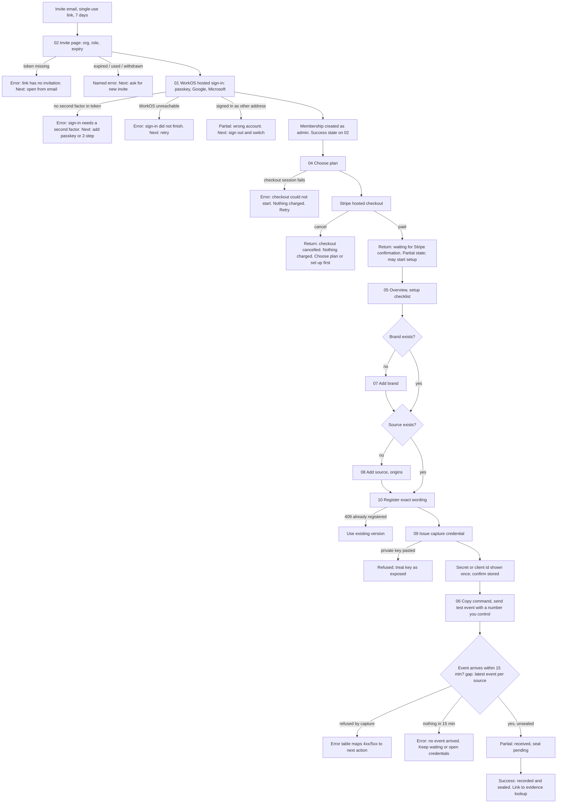
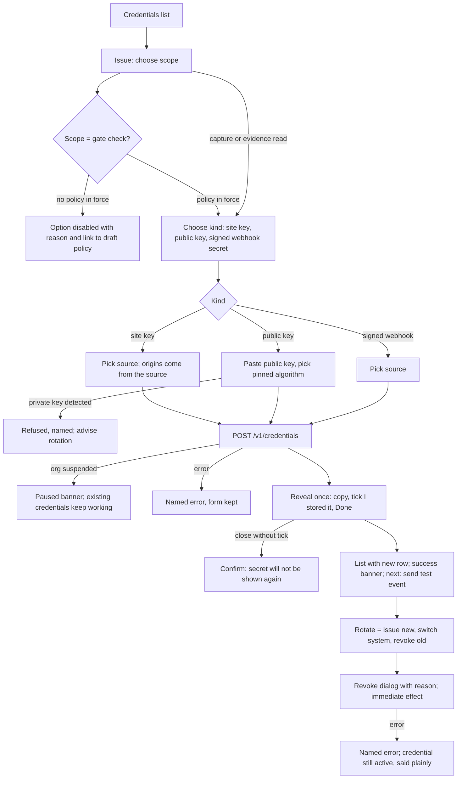
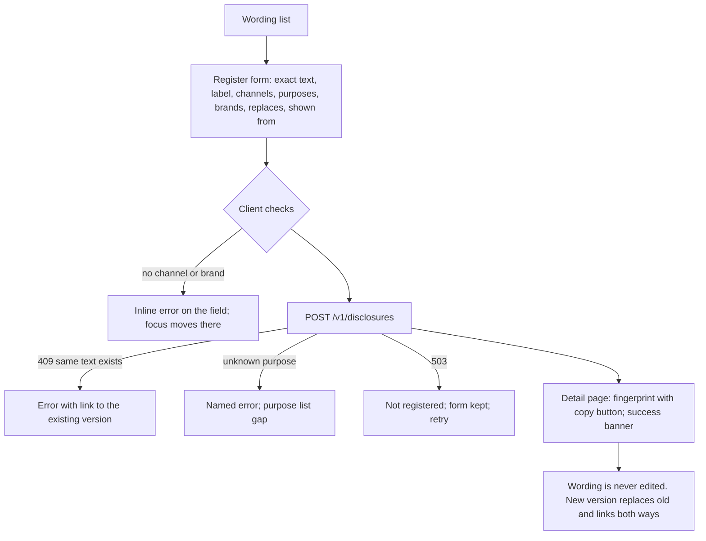
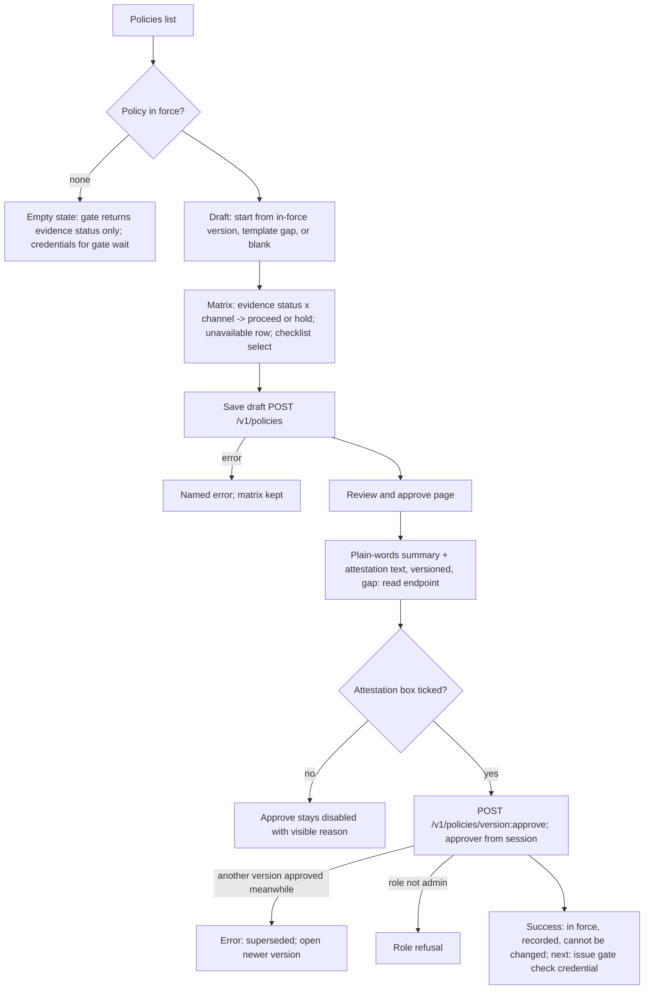
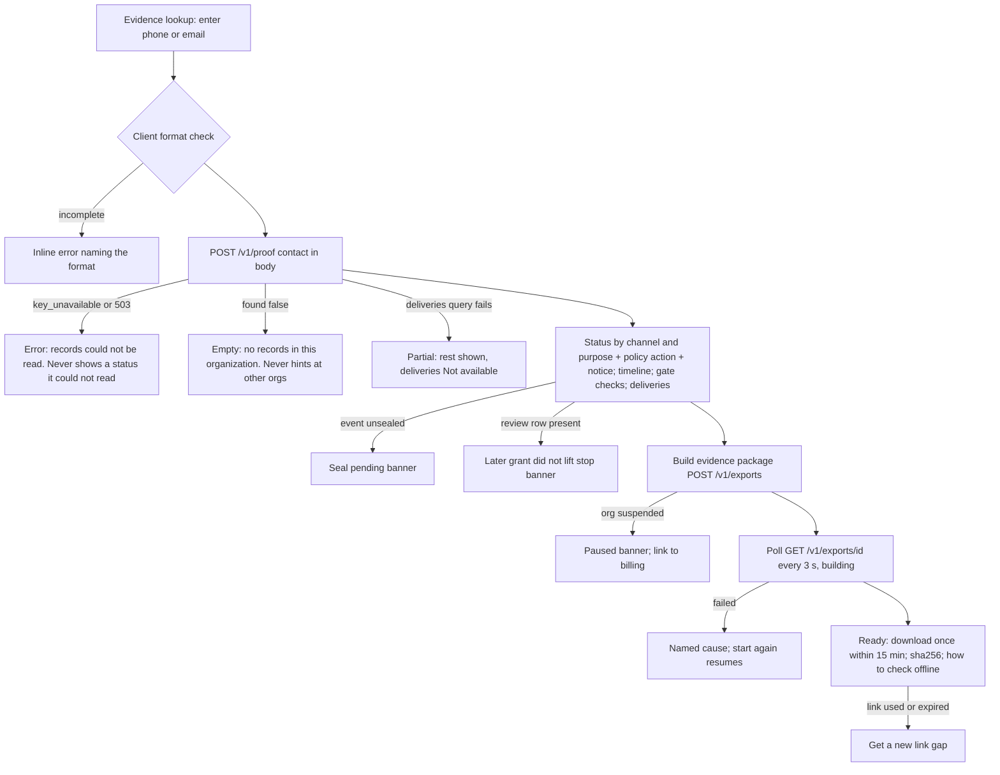
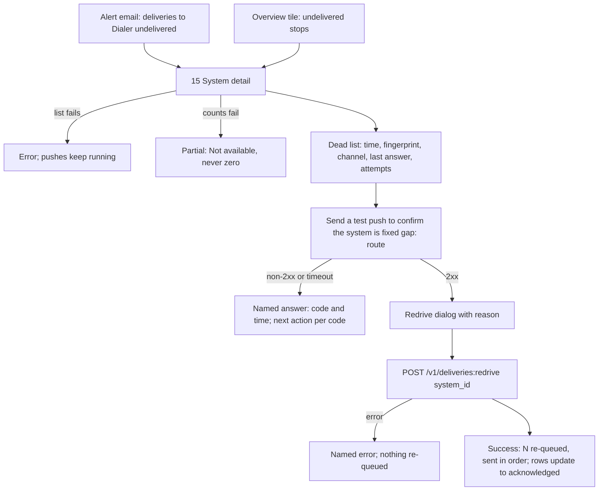
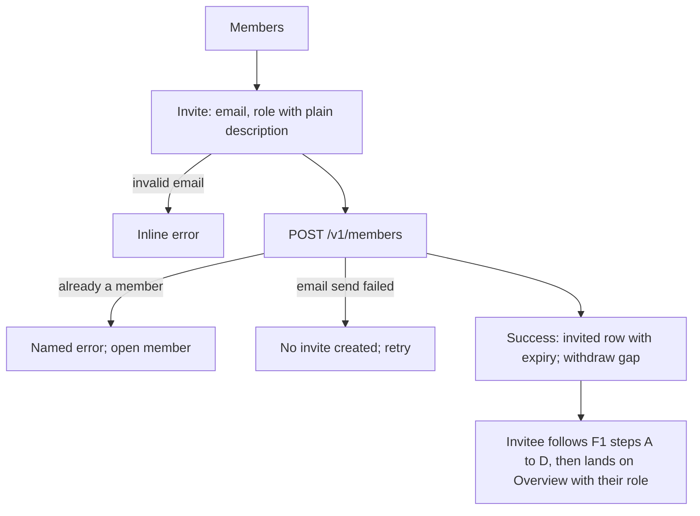
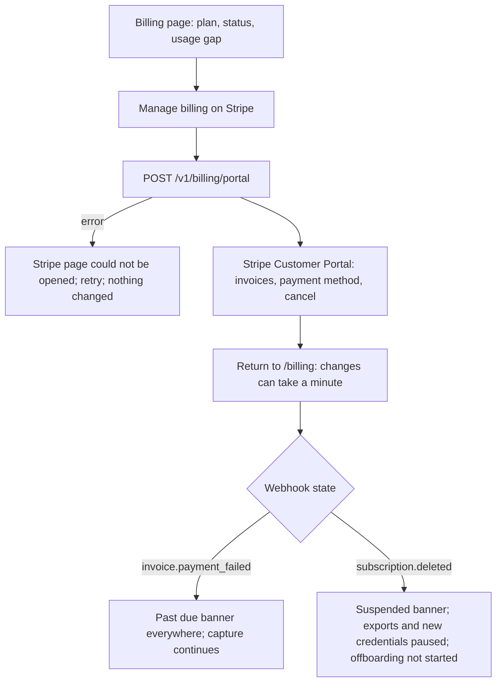
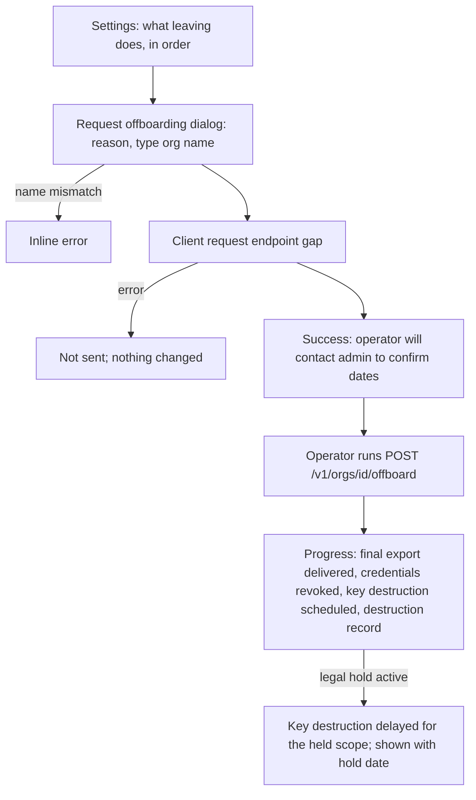
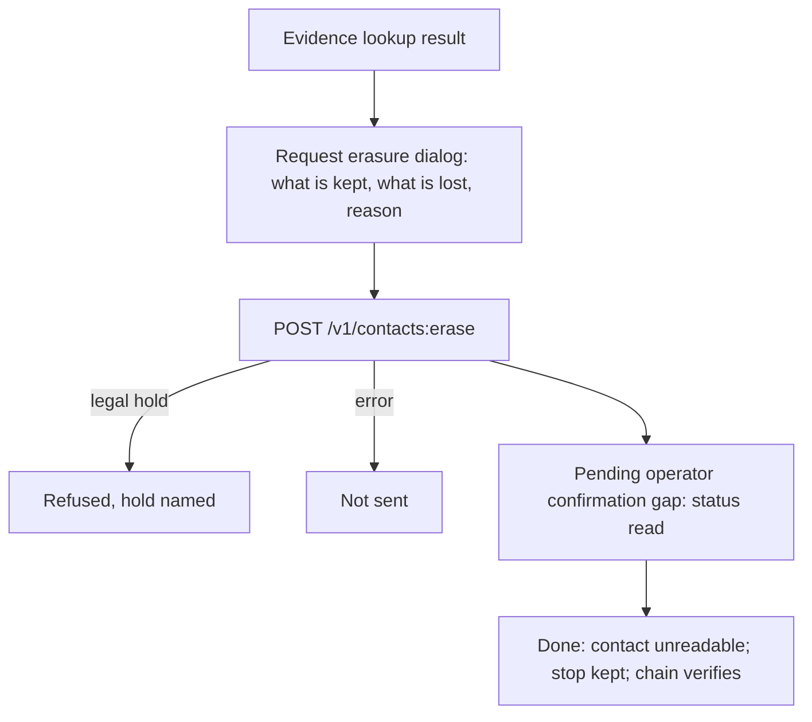

# User flows

Every step has its failure branch. Screen numbers refer to ia.md. Where a step depends on an endpoint no contract
defines, the step is marked **(gap)** and listed in contract-gaps.md.

## F1. Invite to first test event, under 30 minutes (spec: new client to first recorded test event)

Time budget: email to sign-in 3 min; checkout 5 min; brand and source 3 min (often already created by the operator);
wording 5 min; credential 4 min; send and confirm 5 min. Total about 25 minutes.

Decision for Mike recorded in handoff.md open questions: whether setup may proceed before checkout completes in `trial`.
The flow above allows it, because billing.md lets a trial org exist with test data only.

## F2. Issue a credential (screen 09)

## F3. Register consent wording (screen 10)

## F4. Draft and approve a policy with attestation (screen 11)

## F5. Evidence lookup and evidence export (screens 13, 14)

## F6. Suppression deliveries and redrive (screen 15)

## F7. Invite a member (screen 17)

## F8. Billing through Stripe's portal (screen 19)

## F9. Offboarding request (screen 20)

## F10. Erasure request for one person (screen 13)

