# User flows

Every step has its failure branch. Screen numbers refer to ia.md. Where a step depends on an endpoint no contract
defines, the step is marked **(gap)** and listed in contract-gaps.md.

## F1. Invite to first test event, under 30 minutes (spec: new client to first recorded test event)

Time budget: email to sign-in 3 min; checkout 5 min; brand and source 3 min (often already created by the operator);
wording 5 min; credential 4 min; send and confirm 5 min. Total about 25 minutes.

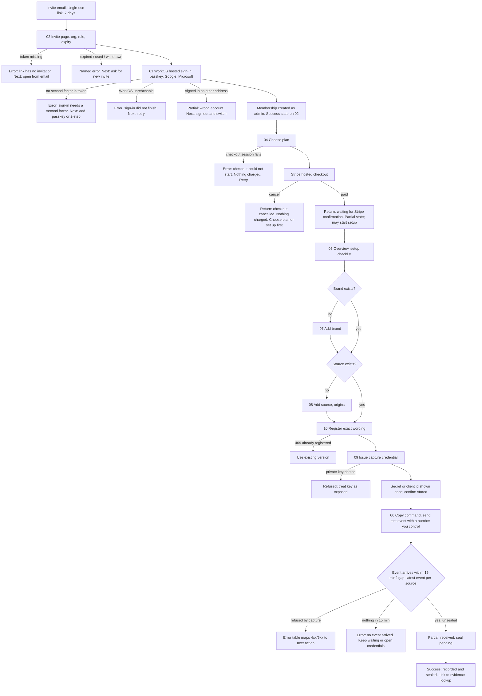

Decision for Mike recorded in handoff.md open questions: whether setup may proceed before checkout completes in `trial`.
The flow above allows it, because billing.md lets a trial org exist with test data only.

## F2. Issue a credential (screen 09)

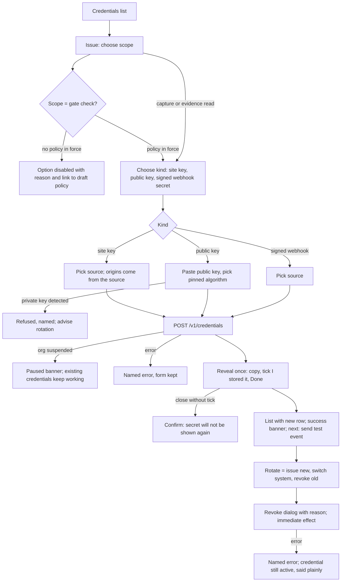

## F3. Register consent wording (screen 10)

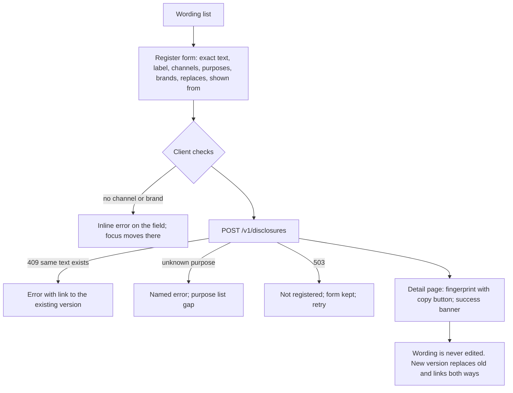

## F4. Draft and approve a policy with attestation (screen 11)

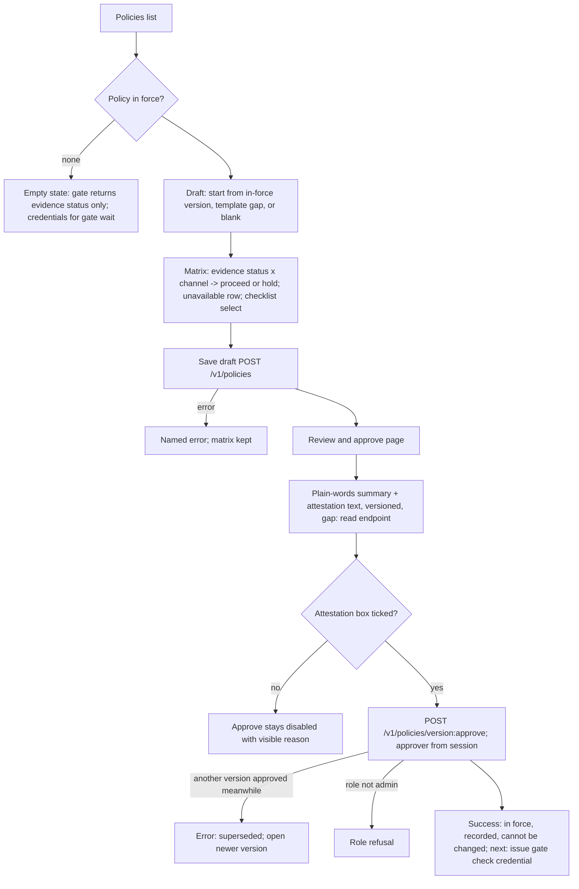

## F5. Evidence lookup and evidence export (screens 13, 14)

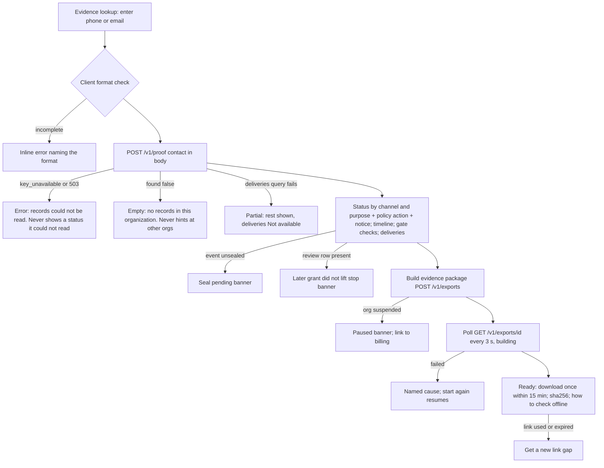

## F6. Suppression deliveries and redrive (screen 15)

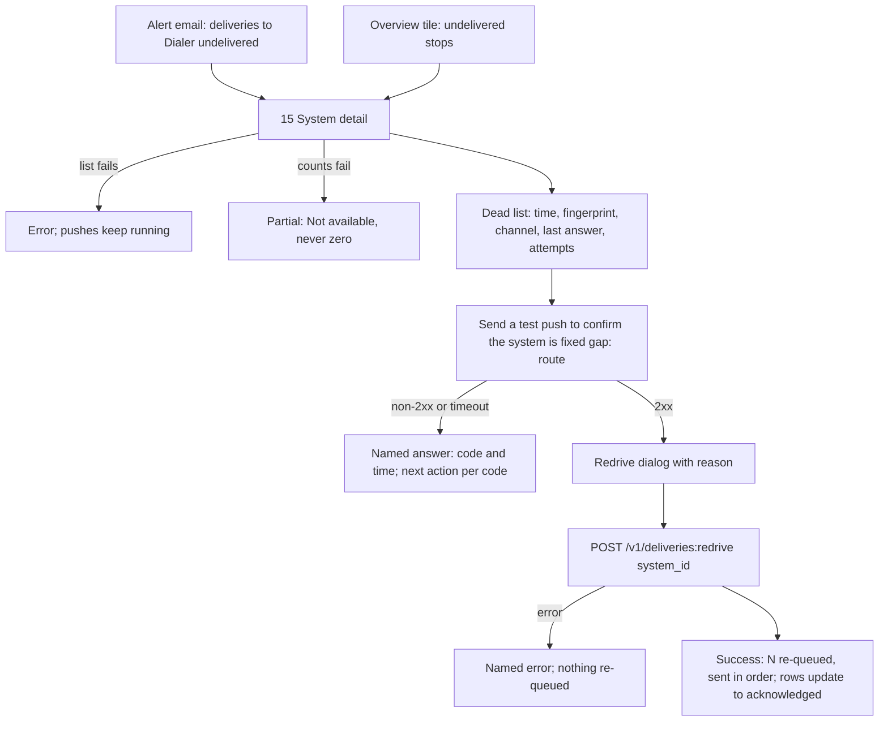

## F7. Invite a member (screen 17)

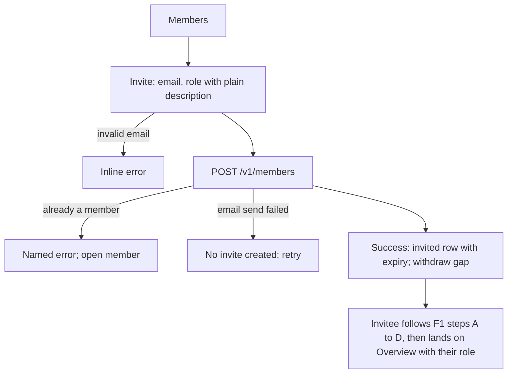

## F8. Billing through Stripe's portal (screen 19)

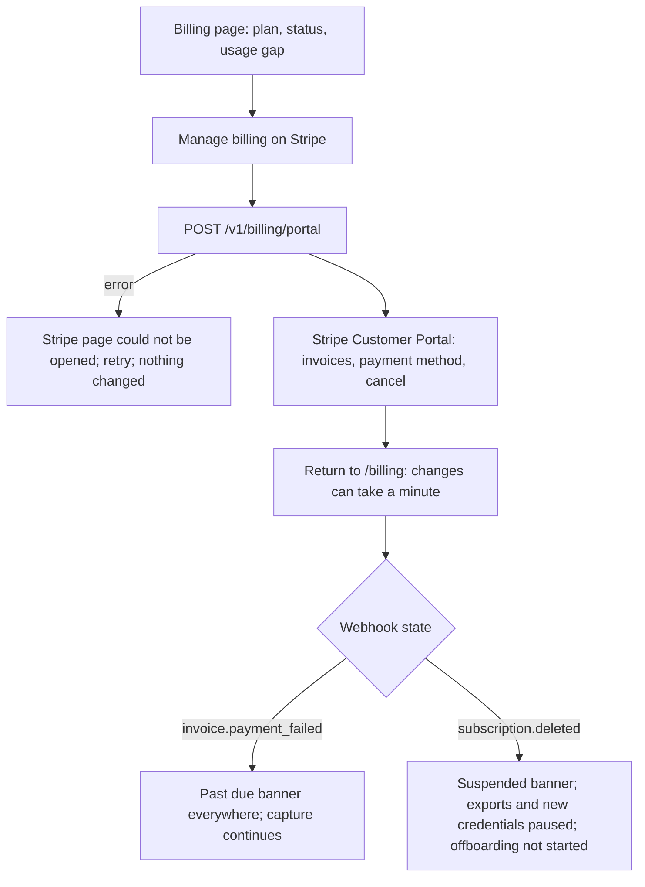

## F9. Offboarding request (screen 20)

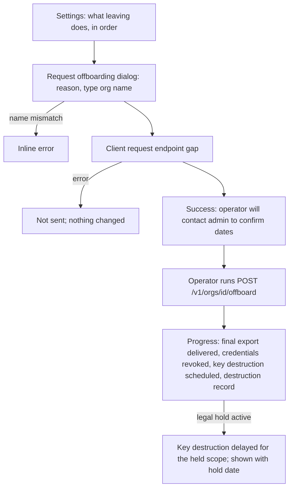

## F10. Erasure request for one person (screen 13)

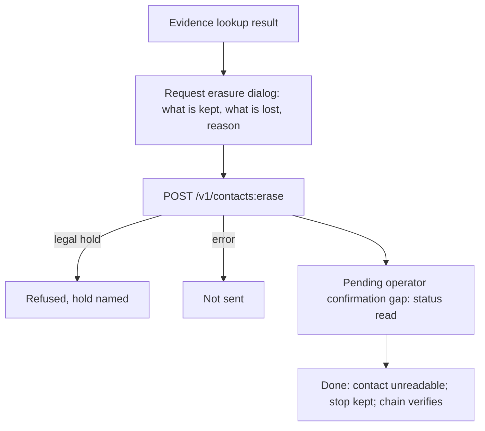

## Additions 2026-10-30

## F11. Work the records list (screen 23)

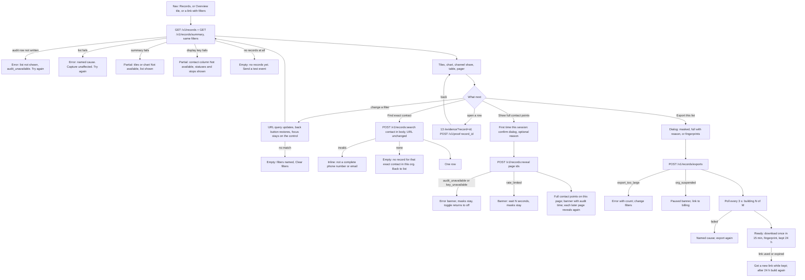

## F12. First-run walkthrough, invitation to first system (screen 24, ties to 05)

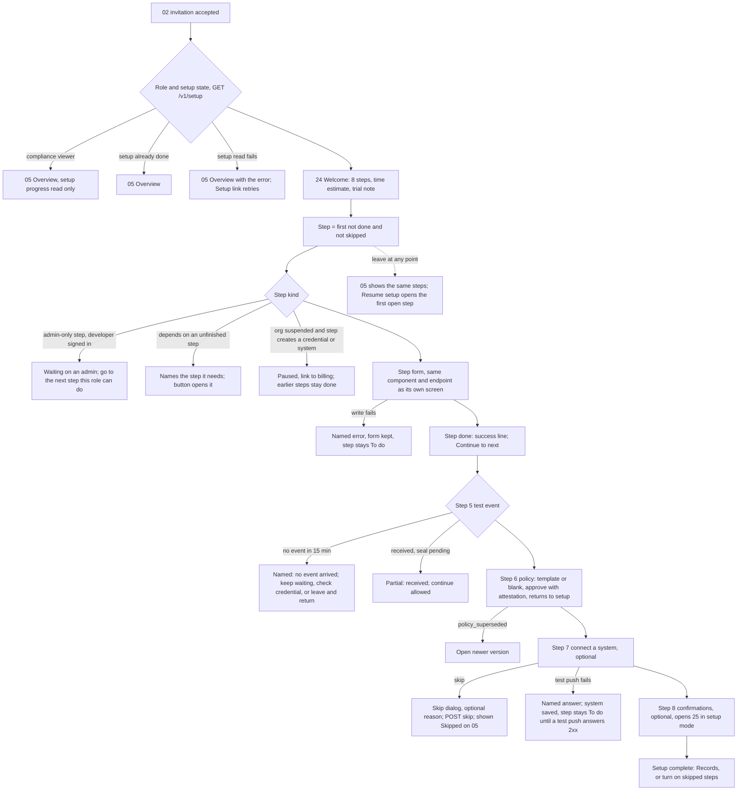

Done is read from the server, never from the browser: a step is done when its fact exists (a brand, a source, a
registered wording, an active capture credential, a recorded event, an approved policy, a connected system with a 2xx
test push, a confirmation rule on). Skips are stored server side with who and when, so another admin or device sees the
same progress.

## F13. A new consent triggers a confirmation (screen 25, evidence on 13). Revised 2026-10-30

```mermaid
flowchart TD
  A[Grant recorded from source S] --> B[Same transaction: one send intent per enabled rule, unique per contact, channel and consent event]
  B -->|duplicate| B0[Nothing new]
  B --> C[Worker locks the intent]
  C --> D{Checks in order: channel in grant, contact kind, sending brand named in grant, arrived within delay, texts only: quiet hours in recipient zone and zone known (email has no sending hours), no stop, no recent confirmation, texting registration and test reply and link host, org active, test-event option}
  D -->|any fails| D1[Skip recorded with its name; never delayed into the next window]
  D --> E[Send from the organization's own domain or number]
  E -->|retryable error| E1[Retry at 1, 2, 4, 8, 16, 32, 57 min; each try re-checks stop, registration, org status, and quiet hours for texts]
  E1 -->|a re-check fails| D1
  E1 -->|still failing after about 2 hours| E2[Dead: recorded, listed under Undelivered, never retried]
  E -->|non-retryable refusal| E3[Failed with provider code; a text opt-out answer also records the stop, F14]
  E --> F[Sent: exact text sealed in the chain; counts as one event; delivery report updates status]
```

## F14. Replies, stop links and START (screen 25, 23, 13). Revised 2026-10-30

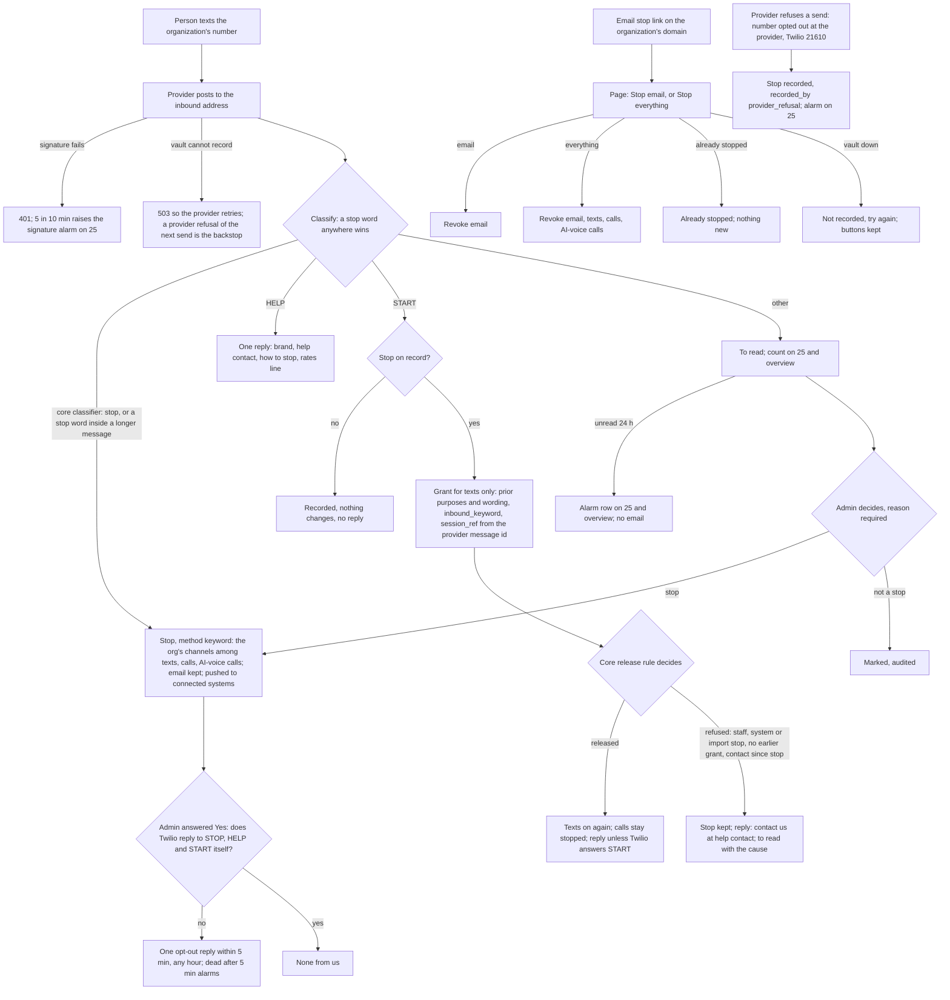

## F15. Turn texts on (screen 25). Revised 2026-10-30

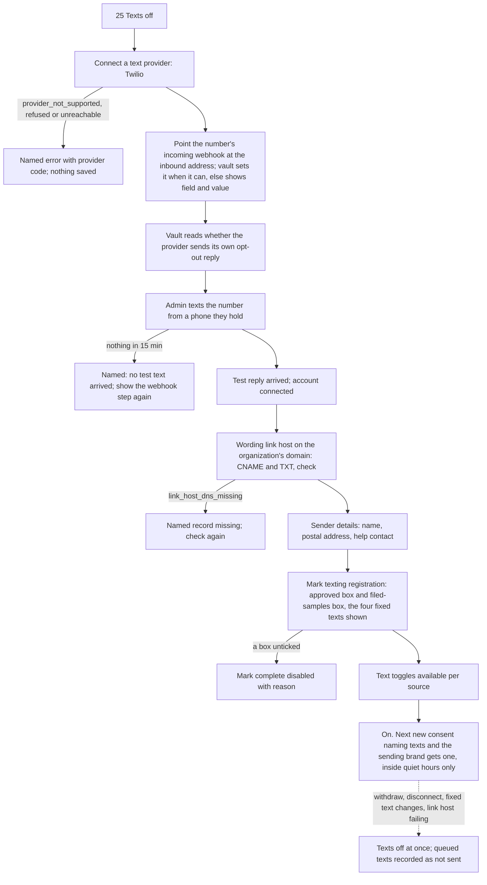
